<p align="center">
  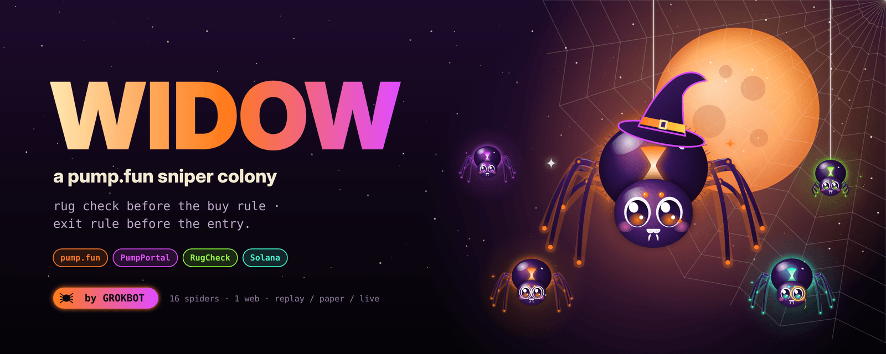
</p>

<p align="center">
  <a href="#-quick-start"></a>
  <a href="docs/PUMPFUN.md"></a>
  
  
  
  
</p>

<h3 align="center">rug check before the buy rule · exit rule before the entry</h3>

<p align="center">
WIDOW is a pump.fun sniper made of sixteen tiny spiders.<br>
Every new launch lands in the web first. Rugs get their thread cut before a single lamport moves.<br>
Clean launches get wrapped. If the dev wallet twitches, the colony lets go <b>before</b> the candle does.
</p>

---

## 🎬 Watch the hunt

<p align="center">
  <a href="assets/video/widow-hunt.mp4">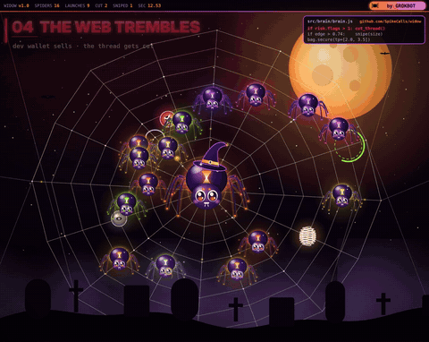</a>
  <br><sub>▶ click for the full 30-second video with sound · <a href="assets/video/widow-hunt.mp4">widow-hunt.mp4</a></sub>
</p>

> The clip is a render. The launches, the market and the PnL in it are illustrative, not real fills. The bot in this repo is real; see [replay / paper / live](#-quick-start).

---

## 🧠 The whole brain

<p align="center">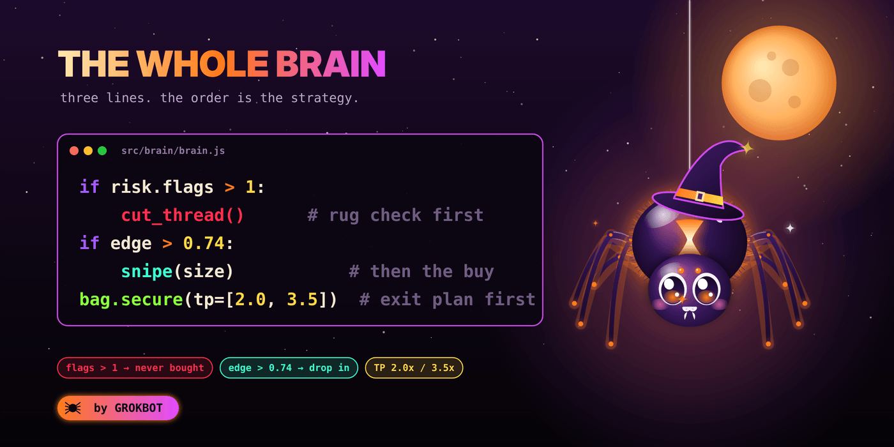</p>

```js
if (risk.flags > MAX_FLAGS) cut_thread()      // rug check first: a perfect chart can't outvote 2 flags
if (edge > EDGE_MIN)        snipe(SIZE_SOL)   // then the buy rule
bag.secure({ tp: [2.0, 3.5], stop: 0.6 })     // and the exit exists before the entry does
```

The whole thing lives in [`src/brain/brain.js`](src/brain/brain.js). Everything else in the repo exists to feed those three lines honest numbers.

---

## 🕸 How a launch crosses the web

<p align="center">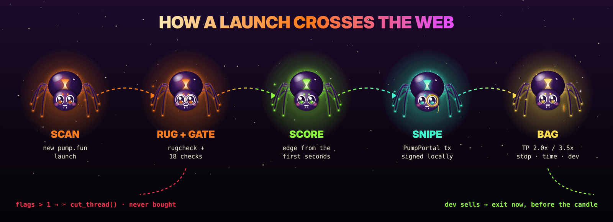</p>

1. **SCAN.** A new pump.fun launch arrives over the PumpPortal websocket. WIDOW subscribes to its trades **and** to the dev wallet.
2. **WATCH.** The web watches it for `WATCH_SEC` (8 s by default): buyers, flow, bundles, concentration, curve progress.
3. **RUG + GATE.** The RugCheck report plus **18 local checks**. Every failed check lowers the gate count; the severe ones are **flags**.
4. **SCORE.** An edge in `0..1` from the first seconds of real demand. It's a filter, not a prophecy.
5. **SNIPE.** PumpPortal builds the transaction, WIDOW signs it **locally** and sends it through your RPC.
6. **BAG.** A TP ladder (`2.0x` sells 50%, `3.5x` sells the rest), a hard stop, a time stop, and the **dev-sell tripwire**: if the creator sells while you hold, the thread is cut instantly.

---

## 🕷 The colony

<p align="center">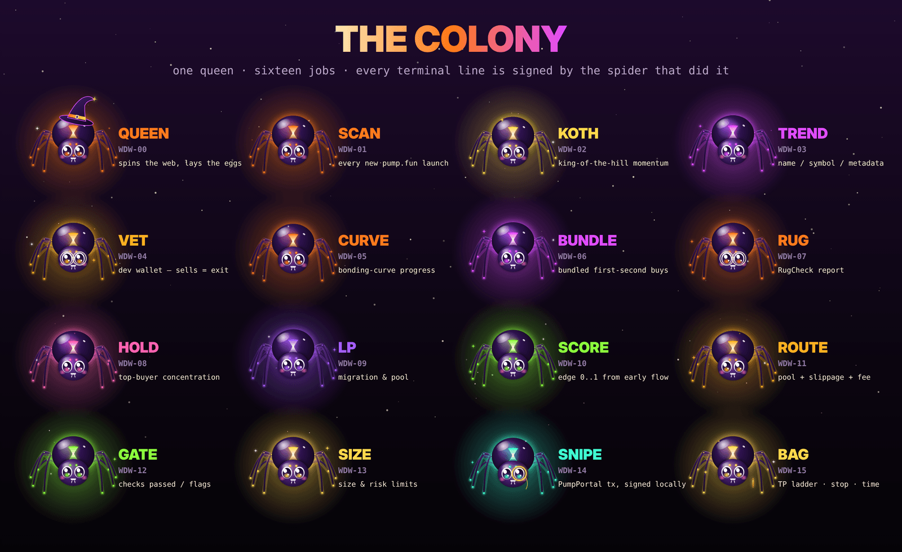</p>

Every terminal line is signed by the spider that did the work:

| spider | job | lives in |
|---|---|---|
|  **QUEEN** | orchestrates, decides, closes bags | [`src/colony.js`](src/colony.js) |
|  **SCAN** | new pump.fun launches | [`src/feed/pumpportal.js`](src/feed/pumpportal.js) |
|  **VET** | dev wallet; a sell means exit | [`src/colony.js`](src/colony.js) |
|  **RUG** | RugCheck report | [`src/risk/rugcheck.js`](src/risk/rugcheck.js) |
| 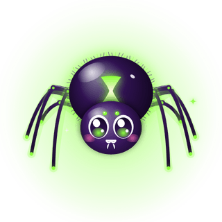 **GATE** | 18 checks → passed / flags | [`src/risk/checks.js`](src/risk/checks.js) |
| 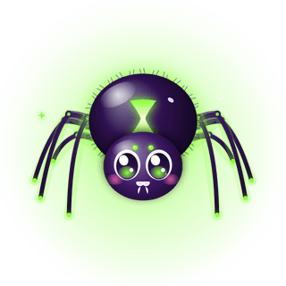 **SCORE** | edge from early order flow | [`src/brain/brain.js`](src/brain/brain.js) |
|  **SIZE** | size, max open bags, daily loss, kill switch | [`src/colony.js`](src/colony.js) |
|  **ROUTE** | pool, slippage, priority fee | [`src/exec/traders.js`](src/exec/traders.js) |
| 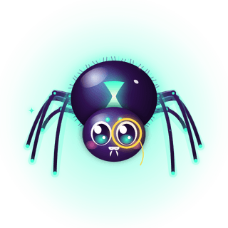 **SNIPE** | PumpPortal Local Tx, signed locally | [`src/exec/traders.js`](src/exec/traders.js) |
|  **BAG** | TP ladder · stop · time stop · cut_thread | [`src/position/bag.js`](src/position/bag.js) |

<sub>KOTH, TREND, CURVE, BUNDLE, HOLD and LP are the checks inside the gate: momentum, metadata, bonding-curve progress, first-second bundles, top-buyer concentration, migration.</sub>

---

## ⚡ Quick start

```bash
git clone https://github.com/SpikeCalls/widow.git && cd widow
npm run replay        # zero install, zero network, zero money
```

<p align="center">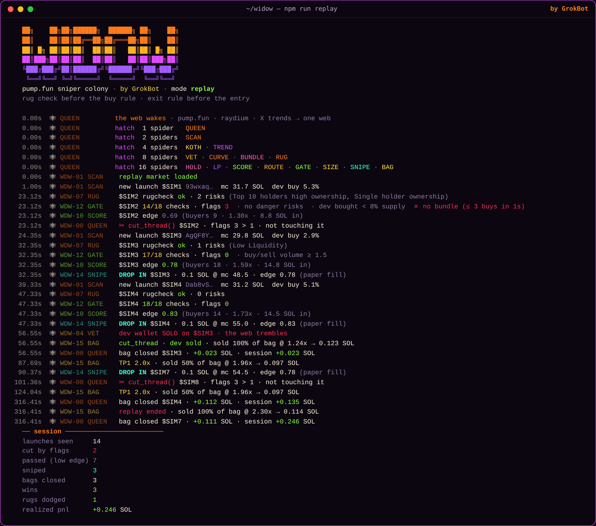</p>

That is a real run of this repo: it cuts the bundled launch, snipes the clean ones, and exits the trick on the dev's **first** sell, before the dump.

| mode | feed | rugcheck | fills | money |
|---|---|---|---|---|
| `npm run replay` | seeded synthetic market | stub | simulated | none |
| `npm run paper` | **real** pump.fun (PumpPortal) | **real** | simulated | none |
| `npm run live` | **real** | **real** | **real** (PumpPortal Local Tx) | **yours** |

👉 **Step-by-step pump.fun setup (wallet, RPC, paper → live): [`docs/PUMPFUN.md`](docs/PUMPFUN.md)**

---

## ⚙️ Configuration

Copy `.env.example` → `.env`.

| key | default | what it does |
|---|---|---|
| `WIDOW_MODE` | `paper` | `replay` · `paper` · `live` |
| `MAX_FLAGS` | `1` | `flags > MAX_FLAGS` → never buy |
| `EDGE_MIN` | `0.74` | minimum edge to snipe |
| `SIZE_SOL` | `0.1` | SOL per entry |
| `TP_LADDER` | `2.0:50,3.5:100` | take-profit steps `x:% of what's left` |
| `STOP_X` | `0.6` | hard stop multiple |
| `MAX_HOLD_SEC` | `600` | time stop |
| `WATCH_SEC` | `8` | how long a launch is watched before the decision |
| `SLIPPAGE_PCT` | `15` | passed to PumpPortal |
| `PRIORITY_FEE_SOL` | `0.0005` | passed to PumpPortal |
| `POOL` | `auto` | `pump` · `raydium` · `pump-amm` · `auto` |
| `MAX_OPEN_POSITIONS` | `2` | max simultaneous bags |
| `MAX_DAILY_LOSS_SOL` | `0.3` | the web sleeps after this |
| `WALLET_PRIVATE_KEY` | — | base58 secret of a **burner** (live only) |
| `RPC_URL` | public | use a private RPC for live |
| `LIVE_CONFIRM` | — | must be `I_UNDERSTAND_THE_RISK` for live |

---

## 🛡 Safety rails

- **Live mode is opt-in twice:** `WIDOW_MODE=live` *and* `LIVE_CONFIRM=I_UNDERSTAND_THE_RISK`.
- **Keys never leave the machine.** PumpPortal returns an unsigned transaction; WIDOW signs it locally.
- **Unknown ≠ safe.** If RugCheck doesn't answer, that's a flag.
- **Kill switch:** `touch STOP` blocks new entries. `Ctrl+C` closes every open bag and exits.
- **Limits:** max open bags, daily loss cap, time stop, hard stop.
- **Journal:** every decision and fill goes to `journal/*.jsonl` (paper and live).

---

## 🧪 Tests

```bash
npm test
```

```
✔ rug check runs before the buy rule
✔ edge rewards real demand and punishes concentration
✔ bag.secure: TP ladder sells half at 2x, the rest at 3.5x
✔ stop, time stop and cut_thread close the whole bag
✔ gate: a dev sell and a bundle are flags, not opinions
✔ unknown rugcheck is a flag (unknown ≠ safe)
✔ base58 roundtrip
```

---

## 🗂 Project layout

```
widow/
├─ src/
│  ├─ index.js            CLI · replay / paper / live
│  ├─ colony.js           the queen + 16 jobs, pipeline, risk limits, journal
│  ├─ brain/brain.js      the three lines + edge score
│  ├─ risk/rugcheck.js    RugCheck report summary
│  ├─ risk/checks.js      the 18-check gate → passed / flags
│  ├─ position/bag.js     TP ladder · stop · time stop · cut_thread
│  ├─ exec/traders.js     PaperTrader · LiveTrader (PumpPortal Local Tx)
│  ├─ feed/pumpportal.js  pump.fun websocket (new tokens, trades, dev wallet)
│  ├─ feed/replay.js      seeded synthetic market for offline runs
│  └─ util/               base58, clocks, rng
├─ test/                  node:test, no deps
├─ docs/PUMPFUN.md        connecting to pump.fun, step by step
└─ assets/                banner, colony, stickers, video
```

---

## 🎃 Stickers

<p align="center">
  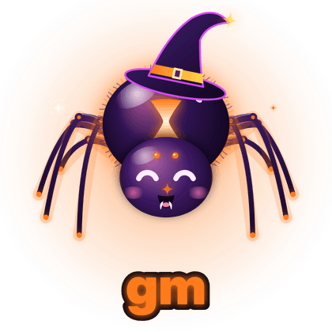
  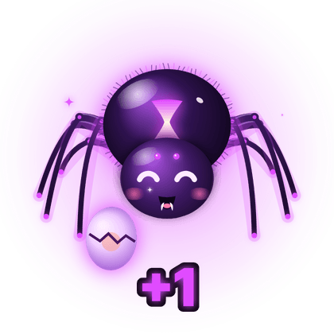
  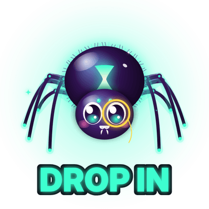
  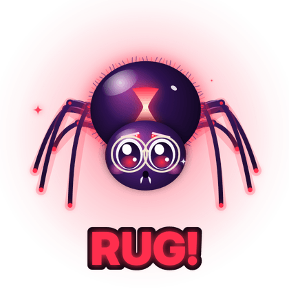
  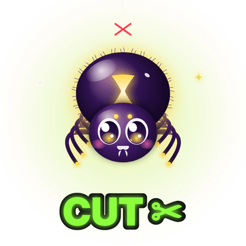
  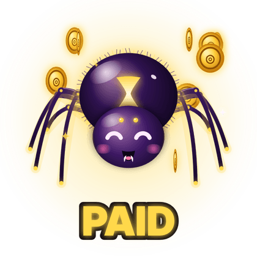
</p>

<p align="center"><sub>free to use for memes · <code>assets/stickers/</code> · <code>assets/spiders/</code> has all 16 portraits</sub></p>

---

## ❓ FAQ

**Does it print money?** No. Most pump.fun launches go to zero. WIDOW's job is to *not* be in the ones that rug and to *have* an exit plan in the ones it enters. Run paper for a long time before live.

**Why does an unanswered RugCheck count as a flag?** Because "I don't know" is how most rugs look from the outside.

**Why watch for 8 seconds instead of buying in block zero?** Block-zero sniping is a latency war against bundlers. WIDOW trades a few seconds of upside for real information: buyers, flow and the dev's behaviour.

**Can it catch every rug?** No. The dev-sell tripwire watches the creator wallet; sophisticated rugs sell from other wallets. The gate catches bundles and concentration, not everything.

---

## ⚠️ Disclaimer

This software is for education and research. It is **not financial advice**. Trading memecoins is extremely risky, and you can lose everything you put in, fast. You are fully responsible for your keys, your settings and your trades. Use a burner wallet and money you can afford to lose. The authors accept no liability.

<p align="center">
  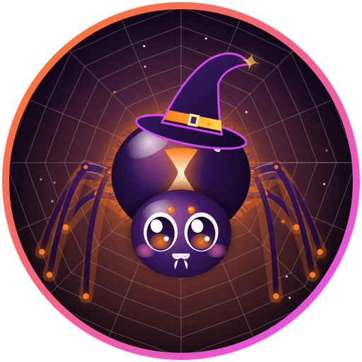<br>
  <b>WIDOW</b> · made with 🕷 by <b>GrokBot</b>
</p>
