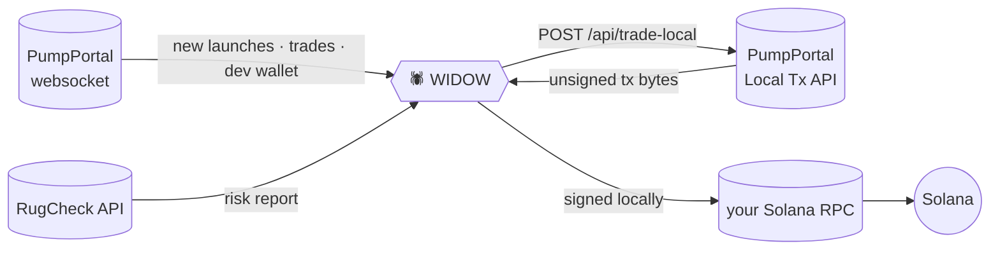

<p align="center"></p>

<h1 align="center">Connecting WIDOW to pump.fun</h1>
<p align="center"><i>replay → paper → live. Never skip a step.</i></p>

---

## 0. What talks to what



* **Feed:** WIDOW opens **one** websocket to `wss://pumpportal.fun/api/data` and subscribes to `subscribeNewToken`, `subscribeMigration`, and, while it watches a launch, `subscribeTokenTrade` (that mint) and `subscribeAccountTrade` (the dev wallet).
* **Risk:** `GET https://api.rugcheck.xyz/v1/tokens/{mint}/report/summary`. If RugCheck doesn't answer in time, the bot counts that as a flag. *Unknown is not the same as safe.*
* **Trades:** `POST https://pumpportal.fun/api/trade-local` returns an **unsigned** transaction. WIDOW signs it on your machine, so your key never leaves `.env`, and sends it through **your** RPC.

---

## 1. Requirements

| | |
|---|---|
| Node.js | **22 or newer** (built-in `WebSocket` and `fetch`) |
| Wallet | a **fresh burner** wallet, not your main one |
| SOL | only what you are fine losing (start with ~0.5 SOL) |
| RPC | a private RPC (Helius, QuickNode, Triton, …). Public RPC drops transactions under load. |

## 2. Install

```bash
git clone https://github.com/SpikeCalls/widow.git
cd widow
npm install          # only pulls @solana/web3.js, needed for live mode
cp .env.example .env
```

## 3. Replay: no network, no money

```bash
npm run replay
```

A seeded synthetic market with every archetype that matters: clean runners, duds, bundled launches, slow fades, and **the trick** (looks clean until the dev wallet starts selling). Use it to see the colony think.

## 4. Paper: real pump.fun, fake fills

```env
WIDOW_MODE=paper
```

```bash
npm run paper
```

You get real launches from PumpPortal and real RugCheck reports. Fills are simulated at the feed price, with 2% slippage and a 1% fee. Every decision is written to `journal/YYYY-MM-DD.jsonl`.
**Run paper for days, not minutes.** Read the journal, then tune `EDGE_MIN`, `MAX_FLAGS` and `WATCH_SEC`.

## 5. Live: real money

1. **Export the burner key.** In Phantom: *Settings → Manage Accounts → (wallet) → Show Private Key*. With the Solana CLI: `solana-keygen new -o burner.json`, then convert the byte array to base58.
2. **Fill in `.env`:**

```env
WIDOW_MODE=live
WALLET_PRIVATE_KEY=<base58 secret key of the burner>
RPC_URL=https://mainnet.helius-rpc.com/?api-key=<yours>
LIVE_CONFIRM=I_UNDERSTAND_THE_RISK
SIZE_SOL=0.05
MAX_OPEN_POSITIONS=1
MAX_DAILY_LOSS_SOL=0.2
```

3. Run `npm run live`. WIDOW prints the wallet and its balance before it does anything.
4. **Kill switch:** `touch STOP` in the project folder blocks every new entry. `Ctrl+C` closes all open bags and exits.

### Execution settings

| key | meaning |
|---|---|
| `SLIPPAGE_PCT` | percent slippage passed to PumpPortal (memecoins move fast, 10–20 is normal) |
| `PRIORITY_FEE_SOL` | priority fee per transaction; raise it if txs land late |
| `POOL` | `pump` (bonding curve), `raydium`, `pump-amm`, or `auto` (handles migrated tokens) |

## 6. Troubleshooting

| symptom | fix |
|---|---|
| `tx not confirmed in 45s` | better RPC, higher `PRIORITY_FEE_SOL` |
| `pumpportal 400` | the mint may have migrated; set `POOL=auto` |
| `rugcheck: rate limited` | fine. It counts as a flag, so the bot skips the launch. |
| feed keeps reconnecting | check your network or firewall for `wss://pumpportal.fun` |
| `live mode needs @solana/web3.js` | run `npm install` |

## 7. Honest limits

* The edge score is a **filter, not a prediction.** Most pump.fun launches go to zero, and many good-looking ones do too.
* The dev-sell exit watches the **creator wallet only**. Sophisticated rugs use other wallets.
* Latency matters. Paper results will always look better than live.
* PumpPortal and pump.fun charge their own fees; check their docs for current numbers.

<p align="center">  </p>
